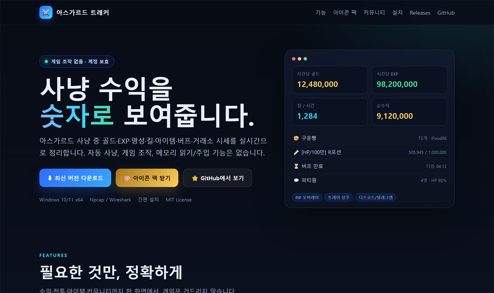

# 아스가르드 트래커

**아스가르드 사냥 수익을 한눈에 보여주는 Windows용 트래커**

[최신 버전 다운로드](https://github.com/qopwa1234/asgard-hunt-meter/releases/latest) · [소개 페이지](https://qopwa1234.github.io/asgard-hunt-meter/)

  
   실시간 수익 대시보드와 커뮤니티 기능

## 소개

아스가르드 트래커는 게임 플레이 정보를 실시간으로 정리해 주는 Windows용 사냥 수익 트래커입니다.

게임 조작, 자동 사냥, 메모리 읽기/주입 기능은 포함하지 않습니다. 게임 이용약관과 계정 보안은 사용자 책임입니다.

- 골드·EXP·명성·킬·아이템·버프를 실시간으로 집계
- 시간당 수익과 최근 5분 흐름, 목표 달성 알림
- 세션 기록과 HTML 리포트, 그래프 CSV 내보내기
- 트레이 상주, PiP 오버레이, 키워드 알림
- 커뮤니티 시세·채팅·기여도 기능
- 앱 안에서 새 버전 확인 및 업데이트

## 주요 기능

| | |
|---|---|
| 수익 대시보드 | 골드 / EXP / 명성, 시간당 수익, 최근 5분 흐름, 목표 알림 |
| 전투 통계 | 킬 수, 몹별 킬 통계, 파티원 HP/MP, 그룹 정보 |
| 아이템 | 획득 목록, 슬롯·스택·충전, 가방 자산 가치, 시세 환산 |
| 버프·소모품 | 남은 시간, 만료 임박 알림, R포션·요리 재고 경고 |
| 채팅 | 채널 필터, 키워드 알림, CSV/TXT 저장, 귓말 모아보기 |
| 대시보드 | 분당 그래프, 세션 기록, HTML 리포트, 그래프 CSV |
| PiP | 게임 위에 표시되는 미니 오버레이 |
| 커뮤니티 | 시세 제보·평가, 채팅, 기여도 포인트, 배지·칭호·닉네임 색상 상점 |
| 아이콘 팩 | 최신 팩 받기, ZIP 가져오기/내보내기 |
| 업데이트 | 앱 안에서 새 버전 확인 → 무결성 검증 → 자동 재시작 |

## 다운로드

1. [Releases](https://github.com/qopwa1234/asgard-hunt-meter/releases/latest)에서 `AsgardHuntMeter-*.zip`을 다운로드합니다.
2. 원하는 폴더에 압축을 풉니다.
3. `AsgardHuntMeter.exe`를 **관리자 권한으로 실행**합니다.

> 표시 이름은 **아스가르드 트래커**로 변경되었습니다. 기존 업데이트·설정 호환을 위해 실행 파일명과 데이터 폴더명은 그대로 유지됩니다.

### 요구 사항

- Windows 10 / 11 64-bit
- [Npcap](https://npcap.com) (Wireshark 설치 시 기본 포함)
- 관리자 권한
- 첫 실행 시 인터넷 연결 (필요한 구성 요소 준비)

> 설치형이 아닌 **포터블 ZIP**입니다. 설정과 기록은 `%APPDATA%\AsgardHuntMeter`에 저장되므로 압축 해제 위치를 바꿔도 유지됩니다.

## 빠른 시작

1. 앱을 실행하고 상단 **▶ 청취 시작**을 누릅니다.
   - 필수 설정은 앱에 내장된 관리 값으로 고정되어 있습니다.
   - 첫 실행 시 필요한 구성 요소와 아이콘을 자동으로 준비합니다.
2. 게임에 접속해 사냥을 시작하면 자동으로 집계됩니다.
3. 아이콘이 비어 있으면 **🌐 커뮤니티 → 아이콘 팩 → 최신 팩 받기**를 누릅니다.
4. **대시보드 → 리포트**로 세션 요약을 HTML로 저장할 수 있습니다.

## 업데이트

> **v0.2.1 이하에서 오시는 경우**: 자동 업데이트 기능이 없습니다. 최신 ZIP을 직접 받아 기존 폴더에 덮어쓰세요. 설정과 기록은 그대로 유지됩니다.

**⚙ 설정 → 🔄 업데이트** 탭에서 새 버전을 확인할 수 있습니다.

- 시작 시 자동 확인 (끄기 가능)
- 새 버전 확인 → 다운로드 → 무결성 검증 → 앱 자동 재시작
- 설정·세션 기록은 `%APPDATA%`에 보존

업데이트가 실패하면 [Releases](https://github.com/qopwa1234/asgard-hunt-meter/releases/latest)에서 ZIP을 직접 받아 기존 폴더에 덮어써도 됩니다.

## 커뮤니티 (선택)

커뮤니티 서버를 연결하면 다른 사용자와 시세·채팅·아이콘 팩을 공유할 수 있습니다.

- 거래소 조회 시 최저가 자동 수집 + 수동 제보
- 제보에 👍/👎 평가, 신뢰도 표시
- 커뮤니티 채팅, 기여도 포인트
- **기여도 상점**: 배지 · 칭호 · 닉네임 색상
- 아이콘 팩 ZIP 업로드/다운로드

첫 실행으로 필요한 구성 요소를 준비한 뒤에는 서버가 없어도 개인 측정 기능이 동작합니다. 커뮤니티 서버는 운영자가 비공개로 운영합니다.

공식 커뮤니티 서버 주소는 앱에 내장되어 있으며 설정에서 변경할 수 없습니다.

> 공식 주소는 앱과 공식 배포 채널에서만 확인하세요. 출처가 불분명한 서버에는 접속하지 마세요.

> 커뮤니티 계정은 게임 계정과 무관합니다. 게임 비밀번호를 입력하지 마세요.

## 아이콘

아이콘 팩은 앱의 **🌐 커뮤니티 → 아이콘 팩**에서 받거나 적용할 수 있습니다.

- **최신 팩 받기**: 최신 아이콘 팩을 내려받아 적용
- **ZIP 가져오기**: 가지고 있는 아이콘 ZIP 적용
- **ZIP 내보내기**: 현재 아이콘을 ZIP으로 저장
- **서버 업로드**: 로그인 후 아이콘 팩 공유

## 데이터와 개인정보

- 설정과 기록: `%APPDATA%\AsgardHuntMeter`
- 게임 계정 비밀번호는 수집하지 않습니다.
- 커뮤니티에는 커뮤니티 전용 닉네임·비밀번호·시세·채팅 내용만 전송됩니다.
- 게임 클라이언트를 조작하거나 메모리를 읽지 않습니다.

## 문제 해결

| 증상 | 확인할 것 |
|---|---|
| 수집이 시작되지 않음 | 관리자 권한, Npcap 설치 여부 |
| 아이콘이 비어 있음 | 아이콘 팩 다운로드 여부 |
| 커뮤니티 연결 실패 | 공식 서버 접속 가능 여부, 방화벽/HTTPS |
| 업데이트 실패 | Releases에서 ZIP 직접 다운로드 후 덮어쓰기 |
| 채팅이 깨져 보임 | 게임 언어/인코딩 설정 |

## 기여

버그 제보와 아이콘 팩 제보를 환영합니다.

- [이슈 템플릿](.github/ISSUE_TEMPLATE)
- [보안 정책](SECURITY.md)

## 라이선스

[MIT](LICENSE)

---

> **고지**: 이 도구는 게임을 자동으로 조작하지 않는 측정 도구입니다. 게임 이용약관과 계정 보안은 사용자 책임입니다.
